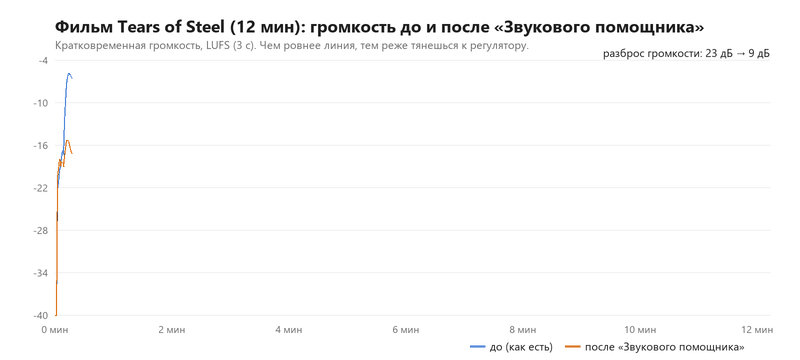
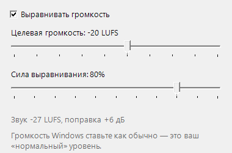

# Ровно — ровная громкость в Windows

**[Скачать бесплатно (Rovno.exe, 34 КБ)](https://github.com/Skeetcher111/rovno/releases/latest/download/Rovno.exe)** · [English below](#english)

Один ролик на YouTube еле слышно, следующий оглушает. В фильме шепчут, потом взрыв, и рука снова тянется к регулятору. Ровно делает это за вас: тихое поднимает, громкое убавляет, резкий скачок срезает сразу. Работает со всеми программами: браузер, плеер, игры, Телеграм.



## Как пользоваться

1. Скачайте `Rovno.exe` и запустите. Установка не нужна.
2. В трее появится оранжевый значок. Всё, громкость уже выравнивается.
3. Громкость Windows ставьте как обычно. Ровно считает её вашим нормальным уровнем и держит звук рядом с ним.

Клик по значку открывает настройки:



- **Целевая громкость** — на каком уровне держать звук.
- **Сила выравнивания** — 100% выравнивает почти всё, 50% оставляет фильму часть его динамики.
- В меню значка: вкл/выкл, автозапуск с Windows (включается при первом запуске), выход. При выходе громкость возвращается как была.

Тихим роликам нужен запас: если громкость Windows стоит на 100%, поднимать уже некуда, и Ровно сможет только убавлять. Удобнее всего держать её на 40–70%.

## Чем отличается

- **Без драйверов и системных модулей.** Ничего не встраивается в звуковую карту, не нужна перезагрузка, нечего удалять. Один файл на 34 КБ.
- **Нулевая задержка.** Звук не проходит через программу, поэтому губы в видео не отстают от голоса.
- **Сам переключается** на наушники, HDMI или Bluetooth, когда меняется устройство вывода.
- **Два ползунка** вместо конфигов и плагинов.
- **И поднимает, и убавляет.** Обычный ограничитель только срезает громкое, а тихий ролик так и остаётся тихим.

## Как это устроено

Ровно не пропускает звук через себя. Программа слушает общий звук системы (WASAPI loopback), меряет громкость по стандарту ITU-R BS.1770 (тот же LUFS, по которому нормализуют YouTube и ТВ) и плавно двигает общий регулятор громкости Windows:

- поднимает не быстрее 3 дБ в секунду, без «качания»;
- убавляет до 10 дБ в секунду;
- если звук за 50 мс прыгнул выше цели больше чем на 5 дБ (взрыв, реклама, уведомление), режет сразу;
- в тишине и паузах ничего не трогает, поэтому шум не вытягивается.

Раз звук идёт мимо программы, у видео нет никакой задержки к картинке, а вылет программы не оставит вас без звука. Цена такого подхода: первые 20–30 мс резкого удара успевают пройти до того, как регулятор сдвинется, и ползунок громкости Windows двигается у вас на глазах.

## Замеры

Модель проверена на реальном звуке тем же кодом (`Rovno.exe --sim вход.wav выход.wav`), что работает в трее, с задержкой регулятора 20 мс. Громкость мерил ffmpeg (ebur128), скрипт `tests/measure.py`.

| Пример | Было | Стало |
|---|---|---|
| Фильм Tears of Steel, 12 мин: разброс кратковременной громкости (5–95%) | 23 дБ (−30…−7 LUFS) | 9 дБ (−26…−17 LUFS) |
| Тот же фильм, диапазон громкости LRA | 20,8 LU | 7,8 LU |
| Тихий ролик, потом громкий: разница между ними | 18 дБ (−26,3 и −8,3 LUFS) | 3,5 дБ (−21,4 и −17,9 LUFS) |

Живой тест на Windows 10: тихий отрывок программа подняла на +12 дБ за 5 секунд, на громком убавила сразу, после выхода громкость вернулась точно на прежний уровень.

## Сборка из исходников

Нужен только компилятор C#, который уже есть в Windows 10 и 11:

```
build.cmd
```

Весь код в одном файле `src/Rovno.cs`, без сторонних библиотек.

Служебные режимы: `Rovno.exe --sim in.wav out.wav [запас_дБ]` прогоняет файл через тот же алгоритм, `Rovno.exe --probe` печатает измеренную громкость.

## Если что-то не так

- Windows может показать «Система Windows защитила ваш компьютер»: файл новый и без платной подписи. Нажмите «Подробнее» → «Выполнить в любом случае». Исходники открыты, можно собрать самому.
- У некоторых звуковых карт loopback идёт до регулятора громкости. Если звук начинает «гулять», добавьте строку `loopback=pre` в `%APPDATA%\Rovno\settings.ini` и перезапустите.
- Ошибки и идеи — в [Issues](https://github.com/Skeetcher111/rovno/issues).

Сделано в [MCPteam](https://mcpteam.ru) — сайты, приложения и программы на заказ. Лицензия MIT. Тестовый фильм — Tears of Steel, (CC) Blender Foundation, mango.blender.org.

---

<a name="english"></a>
# Rovno — even volume for Windows

**[Download for free (Rovno.exe, 34 KB)](https://github.com/Skeetcher111/rovno/releases/latest/download/Rovno.exe)**

One video is too quiet, the next one is deafening; a movie whispers and then explodes. Rovno keeps all system sound at about the same loudness: it lifts quiet content, lowers loud content and cuts sudden bangs at once. Works with every app.

- **No driver, no APO, no reboot.** A 34 KB tray app.
- **Zero added latency.** Audio never passes through Rovno: it measures the system mix (WASAPI loopback, ITU-R BS.1770 / LUFS) and rides the Windows master volume.
- Smooth: up at most 3 dB/s, down up to 10 dB/s, instant guard when loudness jumps 5 dB over the target within 50 ms. Silence is ignored, so noise is not pumped up.
- Follows the default output device (headphones, HDMI, Bluetooth). Restores your volume on exit.
- Your Windows volume stays your "normal" level. Keep it below 100% (40–70%) so there is room to lift quiet videos.

Measured with the same controller code (`--sim`): on the 12‑minute film *Tears of Steel* the short‑term loudness spread went from 23 dB to 9 dB (LRA 20.8 → 7.8 LU); a quiet clip followed by a loud one went from an 18 dB gap to 3.5 dB.

Trade-off: the first 20–30 ms of a sudden bang pass before the volume moves, and you will see the Windows volume slider move.

Build: run `build.cmd` (uses the C# compiler shipped with Windows). Single file, no dependencies. MIT license. Made by [MCPteam](https://mcpteam.ru).
